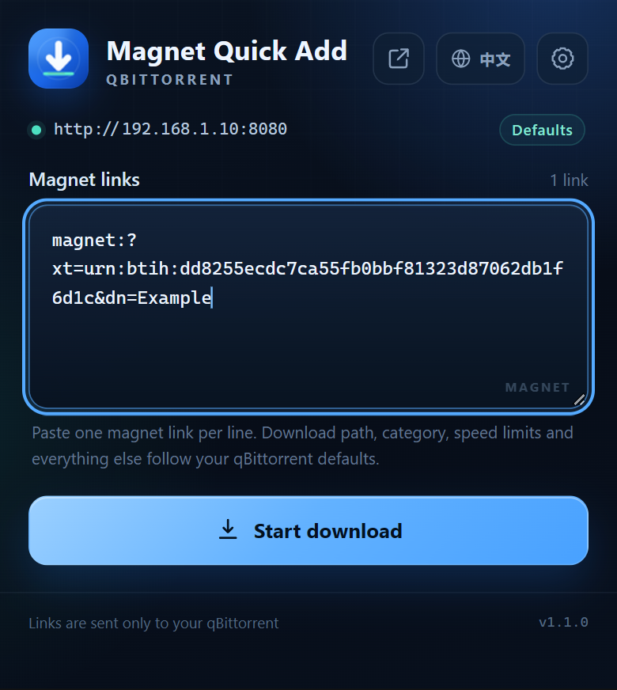
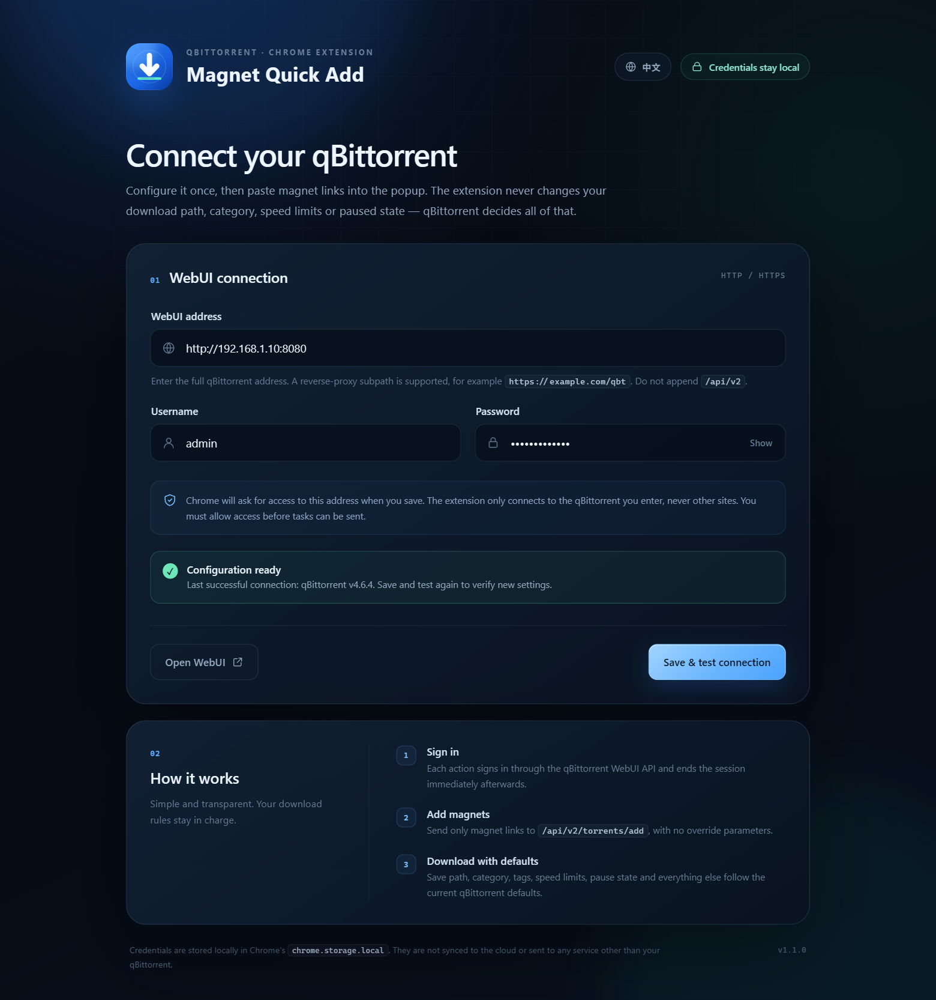
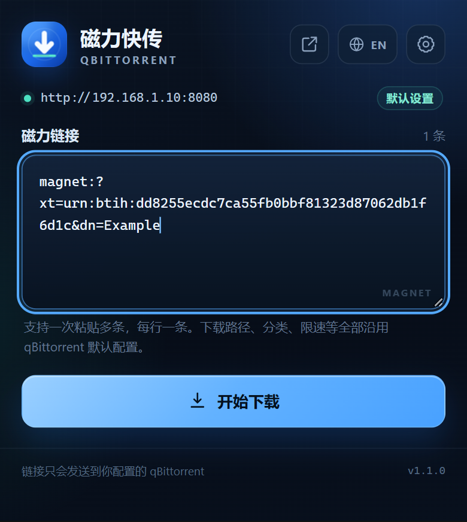
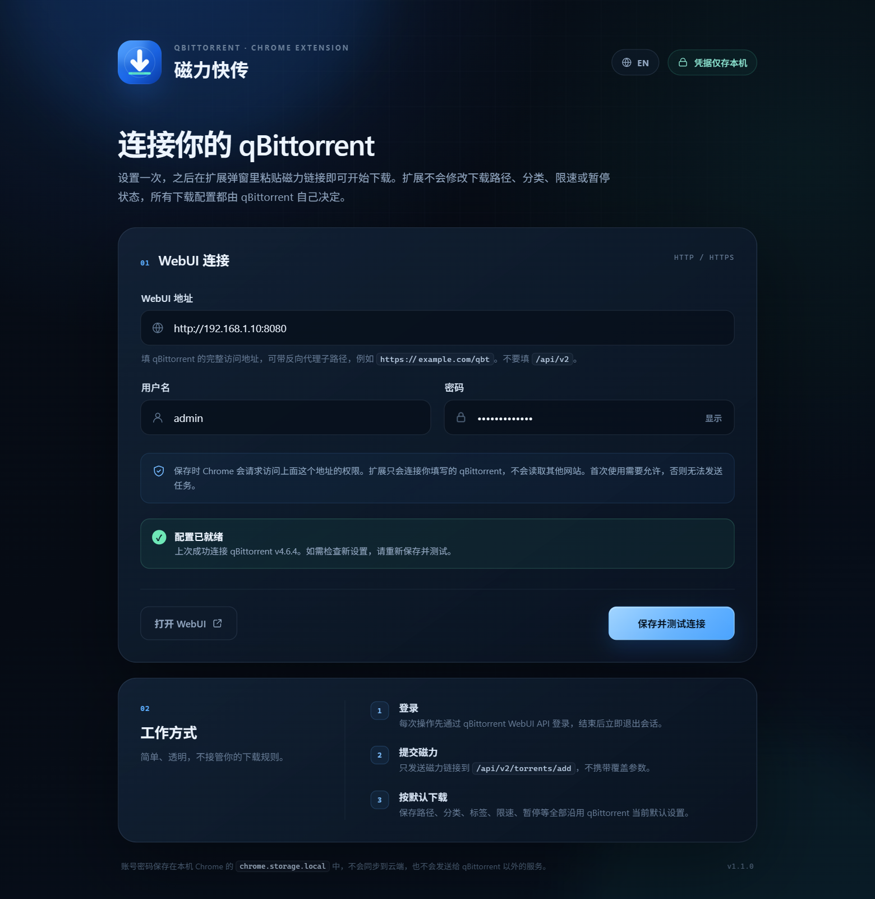

# qBittorrent Magnet Quick Add / 磁力快传

A lightweight Chrome Manifest V3 extension that sends magnet links straight to your own qBittorrent. The UI ships in English and Simplified Chinese. Download path, category, speed limits, paused state and everything else remain under qBittorrent's own defaults.

一个轻量的 Chrome Manifest V3 扩展：把磁力链接直接交给自己的 qBittorrent 下载。界面支持 English 与中文，可随时切换。下载路径、分类、限速、暂停状态等全部由 qBittorrent 的默认设置决定。

**[English](#english) · [简体中文](#简体中文)**

---

## English



### Features

- **English / Chinese UI**: the language button sits in the top-right corner of both the popup and settings page. It shows `EN` while the UI is Chinese and `中文` while it is English. The change applies immediately and is stored locally. English is used by default on first launch.
- Save your qBittorrent WebUI address, username, and password after a real login test.
- Open the toolbar popup, paste one or more magnet links, and submit.
- Uses the qBittorrent WebUI API v2. The extension sends **only the `urls` field** when adding a torrent — never save path, category, tags, speed limits, paused state, or any other override.
- Add multiple links at once (one per line, up to 50 per batch, duplicates removed). Press `Ctrl+Enter` / `Cmd+Enter` to submit.
- Each action uses a temporary session and logs out of qBittorrent afterwards.
- Host access is requested only for the exact address you enter, not for every website.
- The password is kept only in local `chrome.storage.local` and is not synced to the cloud.

### Install

1. Open Chrome and go to `chrome://extensions/` (or `edge://extensions/` in Edge).
2. Enable **Developer mode** in the top-right corner.
3. Click **Load unpacked** and select this folder:
   `quick-qbittorrent-chrome-exten`
4. Pin **qBittorrent 磁力快传** from the extensions menu.

There is no build step and no dependency to install — the folder is the extension.

### First-time setup

1. Click the extension icon, then the gear in the top-right corner. You can also right-click the extension icon and choose **Options**.
2. Enter:
   - **WebUI address**: for example `http://nas.local:8085`, or `https://example.com/qbt` for a reverse-proxy subpath.
   - **Username** and **password**: your qBittorrent WebUI credentials.
3. Click **Save & test connection**.
4. Chrome asks for access to that specific address. Choose **Allow**. The extension cannot reach qBittorrent without it.
5. The configuration is saved only after the test succeeds, and the qBittorrent version is displayed.

> Do not append `/api/v2`, a login page path, or a magnet link to the address; the extension adds the API path itself.
>
> Credentials are not embedded in the extension source or shipped with it. Enter them on the settings page.



### Usage

1. Click the extension icon in the browser toolbar.
2. Paste a magnet link into the field. Add several tasks by putting each link on its own line.
3. Click **Start download** (or press `Ctrl+Enter` / `Cmd+Enter`).
4. **Download started** means qBittorrent accepted the task. Track progress in the qBittorrent WebUI.

The extension does not change qBittorrent's default download behavior. Whether new torrents start paused, the default save path, category, speed limits, automatic management, sequential download, and every other option stay exactly as configured in qBittorrent.

### Switch languages

- In the popup or settings page, click `EN` to switch to English.
- In the English UI, click `中文` to switch back to Chinese.
- Existing text — including form errors and operation results — updates immediately without a page reload.
- The preference is stored in `chrome.storage.local` under `uiLanguage`. The default is English; choose 中文 in the header to switch to Chinese.

### Permissions

| Permission | Purpose |
| --- | --- |
| `storage` | Keep the WebUI address, username, password, last connected version, and language choice on this device. |
| `optional_host_permissions` (HTTP/HTTPS) | Allow connecting to a qBittorrent on any address. Only the host you enter is requested, and only when you save. |

The extension does not inject scripts into pages, read browsing history, intercept downloads, or send data to third-party services.

### Security notes

- Data in `chrome.storage.local` is stored by Chrome in the local profile. It is not a password vault; anyone with access to your Chrome profile may be able to read it.
- Do not save a qBittorrent password on a shared computer.
- If qBittorrent is reachable from the public internet, put it behind an HTTPS reverse proxy and use a strong password. The extension does not bypass certificate validation.
- Over plain HTTP, WebUI credentials and torrent data travel unencrypted on the local network.
- Repeated failed logins may temporarily ban your IP in qBittorrent.

### Compatibility

- Chromium-based browsers such as Chrome and Edge, Manifest V3.
- qBittorrent WebUI API v2.
- Verified with Chrome 156 and qBittorrent `v4.6.4`, including login, host permission, and torrent submission in both Chinese and English UIs.

### Troubleshooting

**“Incorrect username or password”**

Check the credentials on the settings page. qBittorrent WebUI credentials are not necessarily the same as your system account.

**“Login was rejected” or HTTP 403**

Your IP may be temporarily banned after repeated failed attempts. Wait and try again, and check the WebUI authentication / Host header settings in qBittorrent.

**Cannot connect / timeout**

- Make sure the qBittorrent WebUI is running and the address opens in your browser.
- Do not include a trailing `/api/v2`.
- Chrome rejects extension requests to self-signed HTTPS certificates. Use a trusted certificate, or HTTP on a trusted local network.
- If you changed the host or protocol, save the configuration again and grant access.

**Login succeeds but the session does not stick**

Check whether the browser blocks cookies for that site or whether a privacy extension clears site data. Allow cookies for the qBittorrent address and try again.

### Project layout

```text
.
├── manifest.json          # Manifest V3 configuration
├── background.js          # Service worker, messages, operation queue
├── lib/
│   ├── config.js          # URL normalization, validation, magnet parsing
│   ├── i18n.js            # Chinese/English messages, persistence, error text
│   └── qbt-api.js         # qBittorrent WebUI API client
├── popup.html / popup.css / popup.js
├── options.html / options.css / options.js
├── icons/                 # 16 / 32 / 48 / 128 icons
├── store-assets/          # Large icon and Chinese/English UI previews
└── tools/generate-icons.py
```

### Local checks

```powershell
node --experimental-default-type=module --check background.js
node --experimental-default-type=module --check popup.js
node --experimental-default-type=module --check options.js
node --experimental-default-type=module --check lib/config.js
node --experimental-default-type=module --check lib/i18n.js
node --experimental-default-type=module --check lib/qbt-api.js
```

Regenerate icons (requires Pillow):

```powershell
python tools/generate-icons.py
```

---

## 简体中文



### 功能

- **中英文切换**：弹窗和设置页右上角都有语言按钮，当前为中文时显示 `EN`，当前为英文时显示 `中文`。选择会立即生效，并保存在本机。首次使用默认英文，可切换到中文。
- 在扩展设置中保存 qBittorrent WebUI 地址、用户名和密码，保存前先实际登录测试。
- 点击工具栏图标，粘贴一条或多条磁力链接即可提交。
- 使用 qBittorrent WebUI API v2；提交时**只发送 `urls` 字段**，不传保存路径、分类、标签、限速、暂停状态等覆盖参数。
- 支持一次添加多条（每行一条，最多 50 条，重复链接自动去重），也可以按 `Ctrl+Enter` / `Cmd+Enter` 提交。
- 每次操作使用临时会话，操作完成后主动退出 qBittorrent 登录。
- 仅向用户实际填写的域名申请访问权限，不会默认读取所有网站。
- 密码只保存在本机 `chrome.storage.local`，不使用云端同步。

### 安装

1. 打开 Chrome，访问 `chrome://extensions/`（Edge 为 `edge://extensions/`）。
2. 打开右上角的「开发者模式」。
3. 点击「加载已解压的扩展程序」，选择本目录：
   `quick-qbittorrent-chrome-exten`
4. 在工具栏的扩展菜单中把「qBittorrent 磁力快传」固定到工具栏。

不需要安装依赖或构建，目录本身即可加载。

### 首次设置

1. 点击扩展图标，再点击右上角的齿轮；也可以右键扩展图标 →「选项」。
2. 填写：
   - **WebUI 地址**：例如 `http://nas.local:8085`，或带反向代理子路径的 `https://example.com/qbt`。
   - **用户名**、**密码**：qBittorrent WebUI 的登录凭据。
3. 点击「保存并测试连接」。
4. Chrome 会请求访问这个具体地址的权限，选择「允许」。扩展只有在获得权限后才能访问 qBittorrent。
5. 测试成功后配置才会保存，并显示 qBittorrent 版本。

> 地址不要填写 `/api/v2`、登录页或磁力链接；扩展会自动拼接 API 路径。
>
> 账号密码不会写死在扩展代码里，也不会随扩展分发；请在设置页填写。



### 使用

1. 点击浏览器工具栏中的扩展图标。
2. 把磁力链接粘贴到输入框。可以一行一条，一次添加多个任务。
3. 点击「开始下载」（或按 `Ctrl+Enter` / `Cmd+Enter`）。
4. 看到「已开始下载」即表示任务已交给 qBittorrent。之后可在 qBittorrent WebUI 中查看下载进度。

扩展不会修改 qBittorrent 的默认下载行为，例如是否暂停添加、默认保存路径、分类、限速、自动管理、顺序下载等，均以 qBittorrent 自身设置为准。

### 切换语言

- 在弹窗或设置页右上角点击 `EN` 切换到英文。
- 在英文界面点击 `中文` 切回中文。
- 页面上的现有文案，包括表单错误和操作结果，会立即切换；不需要刷新页面。
- 选择保存在 `chrome.storage.local` 的 `uiLanguage` 键中，默认语言为英文；可在页面右上角点击中文切换。

### 权限说明

| 权限 | 用途 |
| --- | --- |
| `storage` | 在本机保存 WebUI 地址、用户名、密码、最近一次连接版本和语言选择。 |
| `optional_host_permissions`（HTTP/HTTPS） | 允许用户连接任意地址上的 qBittorrent；实际只会在保存设置时申请用户填写的那个域名。 |

扩展不注入网页、不读取浏览历史、不拦截下载，也不向第三方服务发送数据。

### 安全提示

- `chrome.storage.local` 中的数据由 Chrome 保存在本机配置目录中，并不是密码保险箱。能访问你电脑 Chrome 用户配置的人可能读到它。
- 不要在共享电脑上保存 qBittorrent 密码。
- 如果通过公网访问 qBittorrent，建议在前面放一层 HTTPS 反向代理，并启用强密码；扩展本身不绕过证书校验。
- qBittorrent WebUI 使用 HTTP 时，登录凭据和任务内容在局域网中明文传输。
- 连续输错密码可能触发 qBittorrent 的 IP 临时封禁。

### 兼容性

- Chrome / Edge 等 Chromium 浏览器，Manifest V3。
- qBittorrent WebUI API v2。
- 已在 Chrome 156 + qBittorrent `v4.6.4` 上完成中文、英文界面下的登录、域名授权、添加磁力任务测试。

### 故障排查

**提示「用户名或密码错误」**

检查设置页中的用户名密码。qBittorrent 的 WebUI 凭据不一定与系统账号相同。

**提示「登录被拒绝」或 HTTP 403**

可能是连续输错密码导致 IP 被临时封禁。等待一段时间后重试；也可以在 qBittorrent 中检查 WebUI 的「验证」和「Host header」相关设置。

**无法连接 / 超时**

- 确认 qBittorrent WebUI 正在运行，并且浏览器可以打开该地址。
- 不要填写以 `/api/v2` 结尾的地址。
- 如果使用 `https://` 自签名证书，Chrome 会拒绝扩展请求；请改用受信任证书或 HTTP（仅限可信局域网）。
- 如果修改过域名或协议，请在设置页再次保存并重新授权。

**登录成功但会话没有生效**

检查浏览器是否阻止了该站点的 Cookie，或是否使用会清除站点数据的隐私扩展。将该 qBittorrent 地址加入 Cookie 允许列表后重试。

### 项目结构

```text
.
├── manifest.json          # Manifest V3 配置
├── background.js          # Service worker / 消息处理 / 操作队列
├── lib/
│   ├── config.js          # 地址规范化、配置校验、磁力解析
│   ├── i18n.js            # 中英文文案、语言持久化、错误提示
│   └── qbt-api.js         # qBittorrent WebUI API 封装
├── popup.html / popup.css / popup.js
├── options.html / options.css / options.js
├── icons/                 # 16 / 32 / 48 / 128 图标
├── store-assets/          # 图标大图与中英文界面截图
└── tools/generate-icons.py
```

### 本地检查

```powershell
# JavaScript 语法检查
node --experimental-default-type=module --check background.js
node --experimental-default-type=module --check popup.js
node --experimental-default-type=module --check options.js
node --experimental-default-type=module --check lib/config.js
node --experimental-default-type=module --check lib/i18n.js
node --experimental-default-type=module --check lib/qbt-api.js
```

重新生成图标（需要 Pillow）：

```powershell
python tools/generate-icons.py
```

---

Version 1.1.0 · Manifest V3
